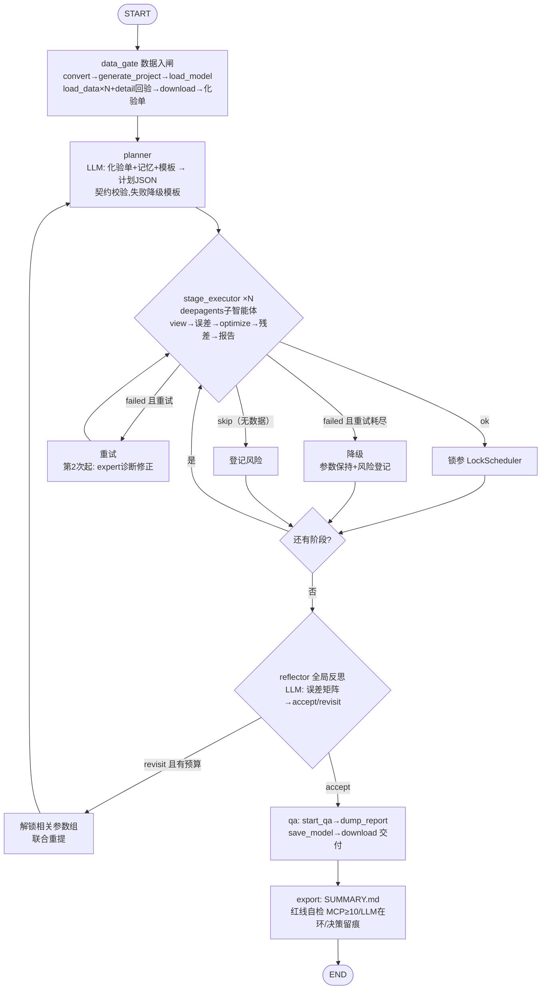

# 架构说明（五层 + 决策流）

## 分层

```
L5 决策层  planner.py / stage_agent.py(deepagents) / expert.py / reflector.py
L4 记忆层  memory/store.py（三级：尝试间→阶段间→跨器件，条件标签）
L3 编排层  graph/builder.py（LangGraph 状态机 + AsyncSqliteSaver checkpoint）
L2 工具层  tools/（signature / residual / locksched / validator —— 全部零 LLM）
L1 基础设施 mcp/client.py（JSONL+BUSY 退避+崩溃恢复链）+ llm/gateway.py（容灾网关）
           data_factory/（ATLAS→PMS，唯一原始数据读取豁免层）
```

## 主图决策流



## 崩溃恢复链（L1，对应已知坑 1/2/7）

```
调用失败(管道断/重复调用异常)
  → pkill -9 -x java（WSL）→ 等 5s
  → 重取 WSL IP → 重启 pmms.exe → initialize(≤180s)
  → open_project（工程/模型/数据自动还原）
  → list_data_sources / list_model_sources 差额补载
  → 重放 last_view（坑2：重开工程后视图组丢失）
  → 重试原调用
```

## 误差测量规约（坑1）

`view → sleep≥5s → get_view_group_error ×2 → 取后者`（`PmmsClient.measure_view_error`）。

## 合规数据通路

```
原始 ATLAS（本地） --data_factory--> PMS（WSL gan_pms）
PMS --MCP load_data--> MeQLab 工程 --MCP download_file--> 本地 out/meas/
本地 out/meas + out/sim（save_sim_result→download_file） --signature/residual--> 化验单/嫌疑参数
```

- `tests/test_guard.py` 静态保证 `src/`（data_factory 除外）不引用本地原始数据路径
- Agent 自身产物（日志/checkpoint/记忆/交付物）本地落盘自由

## 审计（红线）

每运行一个 `logs/run_*.jsonl`：
- `{"type":"mcp_call", seq, tool, arguments, ok, result, duration, retries}` —— 每调用一行
- `{"type":"llm_call", call_id, provider, model, purpose, ok, tokens, response_excerpt}` —— 统计
- `{"type":"decision", node, decision, llm_call_id, payload}` —— 决策序列（引用真实 LLM 调用）

## 失败出口总表

| 故障 | 出口 |
|---|---|
| BUSY(9) | 指数退避 0.5→10s，≤30 次 |
| MeQLab 冷启动超时 | start() 杀 java 重试 ≤3（实测第 2 次必成） |
| MeQLab/pmms 崩溃 | 双层：pmms 自身自动重启 MeQLab（~10s，实测）；客户端崩溃恢复链（上图，实测 33s 误差逐位还原） |
| 恢复后 job 丢失 | JOB_NOT_FOUND(12) → 合成 FAILED → 阶段智能体决策重启优化 |
| LLM 全供应商失败 | 计划降级模板 / 阶段失败报告 / 专家保守建议（全部留痕） |
| 阶段失败 | 重试 ≤3 → 专家修正假设 → 降级（默认值+风险清单）→ 照常交付 |
| 优化器不动参数 | 残差分析器给嫌疑参数 + validator 三查（在卡内/step/界内） |
| save_sim_result 带 path 失败 | 用默认 projectdir/user 落点 + 工程相对路径取回（zip 自动解包） |
| save_model 文件名不符 | 双候选下载回退（套件原 basename） |
| save_current_project 偶发 code8 | 非致命（close 自动保存兜底） |

## 实测踩坑纪要（详见 out/ACCEPTANCE.md）

open_project 不还原数据源/模型源且恢复重放顺序必须与建链一致（模型源先于 filter，否则 view 0 视图）；HEMT 类型在 detail 中归一化为 Mosfet；目录 download 返回 zip 且含嵌套目录。
